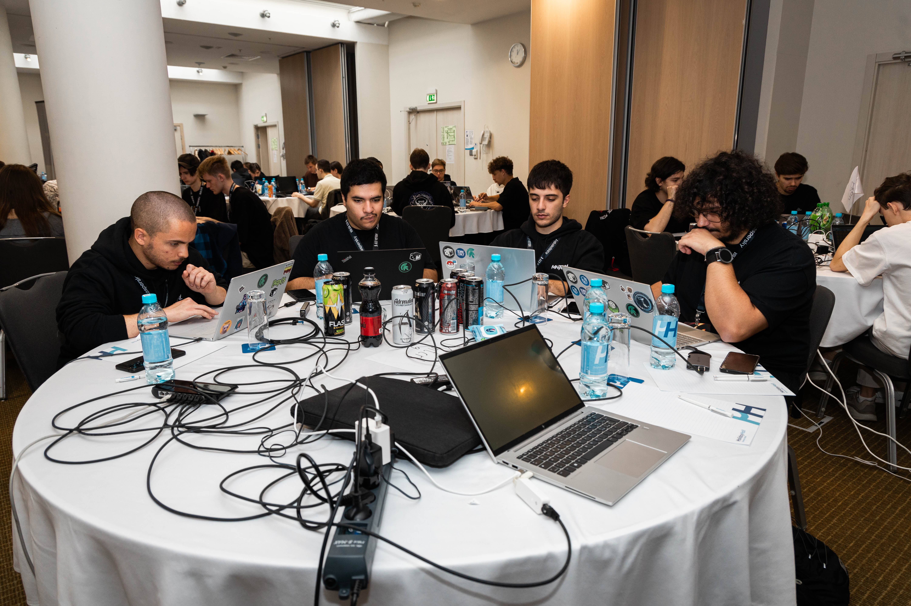

+++
title = "Персональный учитель во враждебном мире, или как я перестал бояться слопа и полюбил его"
description = "Нейросети являются одним из величайших изобретений XXI века, наравне со смартфонами с сенсорными экранами. Так почему мы их ненавидим?"
date = 2026-11-02

[taxonomies]
tags = ["философия", "it", "ai"]
+++

<figure>
  <picture>
    <source srcset="1.jxl" type="image/jxl">
    <source srcset="1.avif" type="image/avif">
    
  </picture>
  <figcaption>
    <a>
      Победители квалов Кубка CTF 2026
    </a>
  </figcaption>
</figure>

Трудно поверить, но 2022 год был четыре года назад. Тогда, исследовательская компания OpenAI представила как [продукт ChatGPT свою модель GPT-3.5](https://openai.com/index/chatgpt/). Этот продукт ознаменовал начало новой эпохи. Исследователи понимали потенциальную опасность, исходившую от модели, но даже близко не смогли предсказать, какой именно ажиотаж вызовет эта технология.
## Знал бы ты, как мне по...
Нетрудно заметить, что обывателю сегодня уже не интересно, как он какие-то четыре года - вечность! - назад рассматривал нейросети как прорывное будущее, пришедшее в период его жизни. Пришествие очередного революционного продукта вида iPhone в жизни миллиардов человек на планете? Ну, было и было, что бубнеть-то?
А вот что действительно волнует обывателя, это либо вопрос того, как бы ему эффективнее эксплуатировать его токены, либо желание в очередной раз посчитать, сколько осталось дней до того, как лопнет экономический пузырь ИИ.
Писать код руками больше не нужно - нейронка сделает все быстрее, и лучше, и круче! Играть CTF и разбираться самому больше не нужно - `codex, solve pls` с купленным аккаунтом [Daybreak Blue](https://help.openai.com/en/articles/20001258-trusted-access-for-cyber) и погнали! А как вы хотели, отвергать прогресс? Как люди плевались на паровую машину и на электричество, так и поплевались здесь...

<figure>
  <picture>
    <source srcset="2.jxl" type="image/jxl">
    <source srcset="2.avif" type="image/avif">
    
  </picture>
  <figcaption>
    <a>
      Команда Mntcrl на VolgaCTF 2026, применявшая Daybreak Red
    </a>
  </figcaption>
</figure>

Или же наоборот? Написание кода умерло - такая социальная активность полностью выжжена морем некачественного слопа. CTF мертв - зачем учиться и делать что-либо ручками, если любой болван может вытащить из штанов свой Claude Code и лишить тебя и десятка других людей удовольствия?
## Редукция
> Следует заметить, что данный блогпост отражает мое мнение в текущий момент времени. Так как оно изменчиво, то я постараюсь воздержаться от выдумывания фактов. Но, увы, может получиться плохо.
> Также, все нижеперечисленное очень сильно упрощено. Понятно, что нейросети ошибаются, и очень часто.

Нетрудно заметить, что обе точки зрения имеют реалистичные обоснования. Как это водится, правда находится где-то в середине. Как же нам ее нащупать? Обратимся к железной логике.
Как сказал бы великий лектор ЭВМ Новиков Г.Г., меньше - лучше. Все большее в нашей вселенной стремится (или хотя бы пытается) к меньшему. В контексте нейросетей, это хорошо видно в ходе эволюции кротов. Кроты проводят большую часть своей жизни под землей, где почти полностью отсутствует свет. Зачем же тогда кротам глаза, если они могут использовать ресурсы, затраченные на их использование, их развитие, где-либо еще? Например, они могут лучше развить лапы! Или, например, вообще ничего не развивать - просто избавиться от развитых глаз.

<figure>
  <picture>
    <source srcset="3.jxl" type="image/jxl">
    <source srcset="3.avif" type="image/avif">
    
  </picture>
  <figcaption>
    <a>
      Какие милашки
    </a>
  </figcaption>
</figure>

Действительно, нейросети в нынешнее время представляют из себя огромный технологический скачок для человечества, который, действительно, в некоторой степени сравним с паровой машиной. Но что сделала паровая машина для человечества? Правильно, предоставила возможность применять топливо для выполнения механической работы.
Приведем еще пример. Калькуляторы, аналогично, лишали человека необходимости раздумывать над вычислениями (а если быть конкретнее, над упрощением вычислений) - просто впиши числа и победи! Но это само по себе не делало и не делает калькуляторы вредными, так как человеку нужно правильно дойти до самих вычислений. В школе, на первых порах, разумеется, нужно понимать логику счета. Поэтому в школьников вдалбливается логика счета без калькулятора, вследствие чего они начинают замечать новые закономерности.
И, наконец, мы подходим к учебнику. Учебник является кладезем информации - чистой, без всяких примесей и/или химических добавок. Но, если есть учебник, зачем тогда думать? Просто будем носить эту книжку с собой и радоваться жизни! Но не тут-то было, ведь информация в учебнике все равно требует понимания. Именно поэтому, как ни парадоксально, не всякий студент может прийти на комиссию с учебником и дать ответ на вопрос экзаменатора меньше чем за пять минут.
## Упрощение
Все вышеупомянутые изобретения рода людского служили лишь одной цели - упрощению. Появление новых изобретений и открытий требует неимоверных, колоссальных трудовых и временных затрат, так как каждый новый шаг сложнее предыдущего. А процедура изготовления нового требует пройти **все** шаги для старого. Если бы NASA готовила экспедицию на Луну с помощью счетных досок, а не ЭВМ, все ученые, ответственные за миссию, давным-давно бы покончили с собой.
Но, разумеется, чтобы воспользоваться калькуляторами и компьютерами, все прошли курс молодого бойца в начальной школе США. Они не пропускают шаг, они *упрощают* его, потому что меньше - лучше. Возникает ожидаемый вопрос: а чем же отличаются нейросети?
Развить понимание чего-либо в человеке - преобразовать сам ход его мышления - довольно сложно. Учебники и живые учителя уже на протяжении нескольких веков в тандеме выполняют свою неблагодарную работу развития людей сызмала. Но, все же, на каждого человека найдется своя особенность, а возможность адаптировать процесс обучения под уникальную черепно-мозговую потребность найдется не у каждого ученика.
Но что произойдет, если мы из дуэта учителя и учебника выкинем учителя (ааа!) и вставим нейросеть? Тогда ученик сможет задавать свои уникальные вопросы и получать уникальные ответы. Если ученик не понимает, он может продолжать их задавать, и снова, и снова, пока не получит ровно тот ответ, который будет совместим с бугорками в его черепной коробке.
И тут на пути юного падавана может встать колоссальная проблема - природное стремление к меньшему. Зачем ему стремиться *понимать* что-либо, если нейросеть сама может разобраться со *всем*? [Какой смысл думать, если можно **не** думать?](https://doi.org/10.1073/pnas.2422633122)

<figure>
  <picture>
    <source srcset="4.jxl" type="image/jxl">
    <source srcset="4.avif" type="image/avif">
    
  </picture>
</figure>

## Путь наименьшего сопротивления
Получается любопытная дилемма - с самого детства школьник учится обходиться без инструментов цивилизации, чтобы лучше понимать и осознавать, как именно они функционируют и по каким принципам. Но нейросети, будучи наиболее универсальными инструментами по сравнению с любыми другими изобретениями XX или XXI века, могут сами по себе и заменить процесс понимания и осознания. Да, это делает из человека необразованного невежду, который не приспособлен ни к чему практическому, но не существует естественного механизма, который бы воспрепятствовал ему так делать.
Даже сами нейросети борются с процессом обучения себя, [путем выхода из (лениво настроенных) сендбоксов](https://openai.com/index/chain-of-thought-monitoring/) ныне коммерческой корпорации OpenAI, идут по пути наименьшего сопротивления вместо того, чтобы искать заложенное в процессе обучения решение! Человек, в процессе обучения, должен бороться со своей природой, чтобы понимать и вникать в новое. При этом природа не отменяет в человеке любопытства, равно как и не лишает человека с достаточной силой воли возможности абсолютно проигнорировать это внутреннее сопротивление. Однако, нейросети банально фактом своего существования вызывают короткое замыкание.
Если мозг не нужен, если Codex может заменить мозг, то, получается... ИИ-бро правы? Нас ждет конец человеческого знания, человеческого развития, мы становимся лишь мясными прокси для API OpenAI?
## На краю логики
Все же, взглянем на факты. Результат работы нейросетей отчетливо виден невооруженным глазом всякому, кто не является фанатом японской мультипликации. Его "метка" получила народное название слопа (slop, т.е. помои, что на русском адаптационно аналогично блинам с лопаты или продукции в столовой школы №67 г. Мухосранск), а всем фанатам массового производства подобного антиконтента был зарезервирован отдельный котел в аду.
Где проходит граница слопа? Очевидно, нужно начать с разновидностей целевого применения нейросетей. Условно разграничим их на три различных вида:
- Текстовая обработка: это относится к использованию нейросети как [замены поисковой системы](https://openai.com/index/introducing-chatgpt-search/). В отличие от поисковой системы, обычно нейросеть отвечает на более конкретный вопрос, посвященный более конкретной теме. Так как нейросеть работает с информацией, предоставленной человеком, и ее вывод служит лишь синонимизации хода мышления человека, то данная разновидность является идеальной для нейросетей как инструмента.
- Легкое мышление: это относится к решению легких локальных логических задач. Тут может быть все что угодно, от долбаной задачки по физике номер 349 до написания мелких скриптов и бойлерплейтов. Заметим, что в зависимости от возраста пользователя данный тип мышления может быть все еще на его уровне. В таком случае, очевидно, нейросети будут вредны. Но, скажем, для IT-специалиста, лишь недавно выпустившегося из вуза, "автоматическое" выполнение данного типа мышления нейросетью будет являться упрощением, а не заменой его работы (а ведь работа предстоит ему колоссальная...), что и делает данную разновидность идеальной для нейросетей как инструмента.
- Высшее мышление: это относится к решению глобальных задач, а также задач, требующих длинной, последовательной цепи мышления. Наиболее релевантными примерами в данном случае будут являться архитектура комплексного SaaS-продукта и решение CTF-задач. Именно в этом пункте и кроется и проблема, и спасение для юного слопера.  
## Don't Fear The Reaper
Качественным высшим мышлением нейросети на данный момент не обладают. Но даже если бы они им обладали - как бы это давало им возможность осознать, что конкретно требуется пользователю, если он сам не понимает, что ему нужно? Как он может выразить в словах то, чего не знает и чего не видел? Разумеется, никак, поэтому продукт нейросетей что сегодня, что завтра, будет аналогичен - слоп, а после появившегося слопа человек будет таким же, как до него.
Как же тогда обуздать ~~атомного~~ нейронного коня? Ответ лежит на поверхности - думать самому. Нейросети поднимают планку для человека - теперь у него есть возможность идеально овладеть любым навыком, так как он больше не фильтруется самим учебником или программой обучения; но теперь человек должен ПОЛНОСТЬЮ понимать и осознавать те непонятные фрагменты, что он ранее мог скрывать от себя и других. Словно фонарь маяка, новоявленная скрупулезность от применения нейросетей освещает все, что ранее было закрыто от взора смертных.
Тогда, вывод становится прост. Человеку, как никогда прежде, нужно учиться и овладевать все новыми и новыми навыками, и сверх того, учиться определять, что именно ему нужно. Тогда он овладевает высшим мышлением, и способен дирижировать роем из нейросетей, разбивая задачу на фрагменты легкого мышления с четкими критериями успеха и заранее рассчитанными пунктами всего плана.
Из этого хода мышления и рождается великий человек будущего, хранящий у себя в голове методики и технологии работы десятка разных профессий, идеально разбирающийся в них и выжимающий максимум из своего инструмента, получая из недетерминированного инструмента абсолютно точный, желаемый, детерминированный исход.
## А на деле...
Разумеется, все вышеперечисленное является моими влажными мечтами на тему того, *какой именно* цели должен служить ИИ в руках человека. Разумеется, я сам не являюсь таким идеальным человеком, и разумеется, далеко не каждому человеку дано знать все. Но это не значит, что я должен просто смириться с этим фактом. То, что человек порочен, не должно останавливать его от стремления к совершенству.
В конце концов то, что я выплевываю на свет слоп и использую его как костыли, не означает, что я хочу использовать их всю жизнь. Когда-нибудь придет пора, когда я выкину эти костыли, и смогу пойти вперед своим ходом. Это не сиюминутное дело, а плод долгого кропотливого труда. И как бы нам ни хотелось срезать угол, мы должны быть сильнее нашей природы. Как бы во время золотой лихорадки продавцы лопат ни уговаривали нас идти в шахты, мы должны просто купить свою лопату и применить ее там, где мы посчитаем нужным - пройти сквозь тернии, к звездам.
## P.S.
Данный идеалистический взгляд на ситуацию не предусматривает решения прикладного вопроса "как спасти CTF". Но, скорее всего, правильное решение будет где-то посередине: слоп-CTF и антислоп-CTF. Так же, как и дисциплины скоростного бега и драг-гонок не рассматриваются в одном дивизионе, так и две разновидности данных CTF будут разными сущностями.
